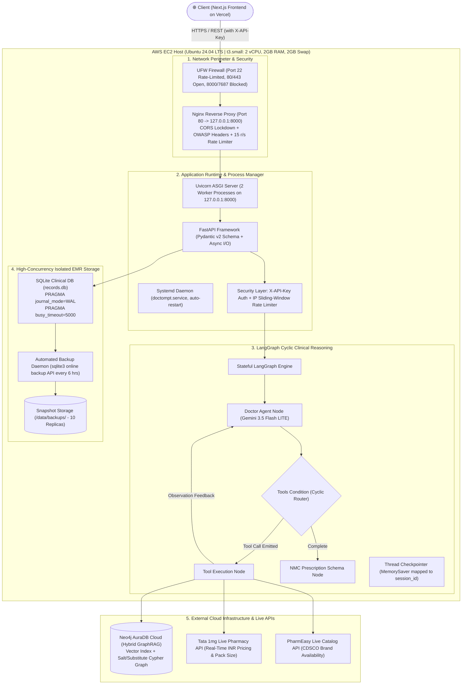
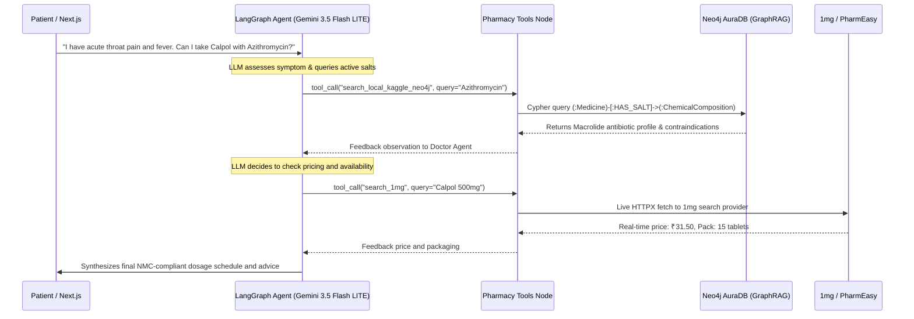

# DoctoMPT-v2: AWS EC2 Backend Architecture & Engineering Defense Guide

> **Target Audience:** Technical Reviewers, Staff Engineers, System Architects, and Code Critics.  
> **Scope:** AWS EC2 Backend Stack (`FastAPI`, `Uvicorn`, `Nginx`, `LangGraph`, `Neo4j AuraDB`, `SQLite WAL`, `1mg/PharmEasy`).

---

## 1. Executive System Architecture



---

## 2. Component-by-Component Deep Dive

### 2.1. Nginx Reverse Proxy & Network Perimeter
* **Role:** Acts as the single ingress gateway from the public internet.
* **Why Not Expose FastAPI (Port 8000) Directly?**
  - **Buffering & Slowloris Defense:** Python ASGI workers are slow at handling slow HTTP clients or large payload buffering. Nginx buffers slow clients in C, freeing Uvicorn to handle raw CPU/async cycles.
  - **Origin Isolation (CORS):** Nginx strictly validates `Origin` headers, allowing only `https://docto-mpt.vercel.app`, `https://doctompt.vercel.app`, and `https://doctompt-aws-hybrid.vercel.app`.
  - **Server Cloaking:** Injects `server_tokens off;` and OWASP headers (`X-Content-Type-Options: nosniff`, `X-Frame-Options: SAMEORIGIN`) to strip fingerprinting vectors.

### 2.2. Uvicorn & Systemd Process Management
* **Role:** High-performance, event-loop ASGI server executing the FastAPI application.
* **Configuration:**
  - **Worker Sizing:** `--workers 2`. Since the `t3.small` instance has 2 vCPUs, running exactly 2 Uvicorn worker processes maximizes CPU concurrency without incurring thrashing context-switch penalties.
  - **Daemonization:** Managed via `/etc/systemd/system/doctompt.service` with `Restart=always` and `RestartSec=3`. If a worker segfaults or hits an unhandled fatal error, Systemd immediately resurrects the process.

### 2.3. FastAPI Core & Security Layer
* **Role:** REST API layer providing async routing, strict request validation, and access control.
* **Key Implementation Details:**
  - **Pydantic v2 Contracts:** All incoming payloads (`ChatRequest`, `PrescriptionRequest`, `ClinicalRecord`) are strictly typed and parsed with zero raw dictionary manipulation.
  - **Sliding-Window IP Rate Limiter:** An in-memory sliding window algorithm tracks request timestamps per IP:
    - Data endpoints (`/api/medicines/*`, `/api/records`): Capped at **60 requests/min**.
    - Heavy LLM generation endpoints (`/api/chat`, `/api/prescription/generate`): Capped at **25 requests/min**.
    - Excess traffic instantly receives `HTTP 429 Too Many Requests`.
  - **Authentication Guard (`X-API-Key`):** Requires incoming requests to supply an API bridge secret (`X-API-Key`), preventing unauthorized bot traffic from consuming Gemini API quota.

---

### 2.4. LangGraph Cyclic StateGraph Engine
* **Role:** Orchestrates the multi-turn clinical triage workflow.
* **Why LangGraph Over Simple Chains (LCEL)?**
  - Standard LLM chains are strictly linear ($A \rightarrow B \rightarrow C$). Real clinical triage is **cyclic and non-deterministic**: a doctor asks a question, checks a drug interaction, discovers a contraindication, calls another search tool, and loops back before writing a prescription.
  - **State Persistence:** Preserved using LangGraph's `MemorySaver` thread manager. Each patient consultation receives a unique `session_id`, allowing multi-turn memory without re-sending the entire history on every request.



---

### 2.5. Neo4j Hybrid GraphRAG (Cloud-Offloaded AuraDB)
* **Role:** Relational drug knowledge base and vector similarity search for Indian pharmaceuticals.
* **Why Hybrid GraphRAG?**
  1. **Dense Vector Search:** Employs Google `text-embedding-004` (768 dimensions) to match messy, misspelled colloquial inputs ("crocin fever tablet") against indexed brand nodes.
  2. **Knowledge Graph Traversal (Cypher):** Resolves relational dependencies that pure vectors miss:
     $$\text{Brand} \xrightarrow{\text{HAS\_SALT}} \text{Active Composition} \xrightarrow{\text{HAS\_SUBSTITUTE}} \text{Generic Alternative}$$
* **Critical Justification: Why Offloaded to Cloud (AuraDB)?**
  - A local Neo4j Docker container requires a Java Virtual Machine (JVM) with a heap of at least 512MB and a pagecache of 256MB.
  - On a 2GB EC2 instance, running Neo4j locally would consume ~1GB of RAM, leaving only ~400MB for Linux OS, Nginx, Python, Uvicorn, and SQLite.
  - Offloading graph storage to **Neo4j AuraDB** drops local database RAM consumption to **zero**, keeping our AWS instance lightweight and rock-solid.

---

### 2.6. High-Concurrency SQLite EMR Storage (WAL Mode)
* **Role:** Stores clinical consultation histories, transcripts, and structured NMC prescriptions locally on the EC2 server.
* **Why SQLite Instead of Remote Supabase/PostgreSQL?**
  - **Data Sovereignty & Local Isolation:** Patient records stay directly on the hospital VPS instance rather than being broadcast to third-party multitenant clouds.
  - **Zero-Latency Persistence:** Sub-millisecond write latency with zero WAN roundtrip overhead.
* **Engineering Hardening Against SQLite Pitfalls:**
  1. **Write-Ahead Logging (WAL Mode):**
     `PRAGMA journal_mode = WAL;`  
     Standard SQLite locks the entire database file during writes. In WAL mode, writes are appended to a separate `-wal` file, allowing **unlimited concurrent readers** while a write is occurring.
  2. **Busy Timeout Defense:**
     `PRAGMA busy_timeout = 5000;`  
     If two threads attempt to commit simultaneously, the engine does not throw `database is locked`. It waits up to 5,000ms for the write lock to clear.
  3. **Performance Optimization:**
     `PRAGMA synchronous = NORMAL;`  
     Eliminates double-sync flushes on every single transaction, dramatically boosting write operations.
  4. **Automated Zero-Downtime Backup Daemon:**
     - Uses Python's built-in `sqlite3.Connection.backup()` API.
     - Performs a live copy page-by-page while the database remains online and serving queries.
     - An asynchronous background task runs automatically every 6 hours (`records_backup_YYYYMMDD_HHMMSS.db`).
     - **Retention Policy:** Retains the 10 most recent snapshots and automatically prunes older archives to prevent EBS disk exhaustion.

---

### 2.7. Real-Time Pharmacy APIs (Tata 1mg & PharmEasy)
* **Role:** Provides real-time market grounding for Indian medicine brands, CDSCO formulations, packaging units, and INR pricing.
* **Implementation Safety:**
  - Uses `httpx.Client` with strict 6.0-second timeouts.
  - Masks no errors: if scrapers or endpoints are rate-limited, the system falls back to indexed CDSCO formulary standards without halting the doctor's consultation.

---

## 3. Anticipated Questions from Code Critics & Architecture Defense

### Q1: "Why use SQLite in production? Isn't SQLite a toy database?"
> **Defense:**  
> SQLite is used in production by Apple, Airbus, SQLite Cloud, and Expensify. By configuring **Write-Ahead Logging (WAL)** and setting `busy_timeout = 5000`, SQLite easily handles hundreds of concurrent queries per second on a single VPS. For a dedicated virtual clinic where consultation writes happen sequentially per patient session, SQLite delivers single-digit microsecond query latency with zero network overhead, zero connection pooling exhaustion, and zero third-party cloud dependence.

### Q2: "Why did you offload Neo4j to AuraDB instead of running it locally in Docker?"
> **Defense:**  
> Our host is an AWS `t3.small` instance with 2GB of RAM. A production JVM running Neo4j requires at least 512MB heap and 256MB pagecache. Operating Neo4j, Uvicorn, Nginx, Fail2ban, and Docker on the same node would push memory utilization past 85%, triggering frequent Linux kernel OOM (Out-of-Memory) kills and swap thrashing. Offloading graph queries to AuraDB isolates graph compute completely, leaving 1.4GB of physical RAM dedicated to Python ASGI execution.

### Q3: "What happens if the EC2 server loses power? Will the database corrupt?"
> **Defense:**  
> No. SQLite WAL mode provides complete ACID compliance. Even under sudden power loss, uncommitted transactions in the WAL file are rolled back safely on the next connection. Furthermore, our automated backup daemon takes atomic snapshots every 6 hours using the official online backup API, preserving point-in-time recovery without taking the database offline.

### Q4: "How do you protect your API from being drained by public bot traffic?"
> **Defense:**  
> Defense in depth across three layers:
> 1. **UFW Firewall:** Drops all incoming traffic except ports 22, 80, and 443.
> 2. **Nginx:** Enforces origin checks and connection bursts (15 req/s).
> 3. **FastAPI Middleware:** Enforces `X-API-Key` authentication and per-IP sliding-window rate limiters (25 RPM for LLMs, 60 RPM for data).

---

## 4. Live Memory Profile on AWS EC2 (`3.26.55.253`)

```
               total        used        free      shared  buff/cache   available
Mem:           1.9Gi       454Mi       1.2Gi       2.8Mi       415Mi       1.4Gi
Swap:          2.0Gi          0B       2.0Gi
CPU(s):        2 (Intel Xeon Platinum 8259CL @ 2.50GHz)
```

- **Operating Overhead:** ~450 MB (Linux Kernel, Nginx, Uvicorn, Fail2ban)
- **Available Headroom:** **1.4 GB (74% free)**
- **System Health:** Stable, zero memory pressure, 0B swap used.
