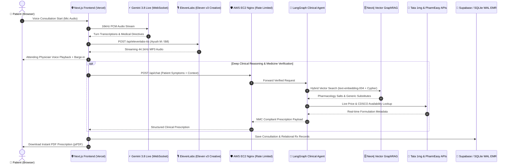

# 🗺️ Archify & Graphify — System Topology & Codebase Knowledge Graph

DoctoMPT integrates **Archify** and **Graphify** to provide both **visual architectural transparency** and **deterministic semantic code intelligence**. This document outlines how both tools are utilized across the platform, how to generate interactive diagrams, and how to query the codebase knowledge graph without consuming LLM token context.

---

## 🏛️ 1. Archify — Visual Architecture & Call-Flow Maps

**Archify** transforms complex, distributed full-stack codebases into interactive visual architecture diagrams, sequence maps, and execution flowcharts. In DoctoMPT, Archify maps the dual-runtime architecture spanning **Next.js 16 (Vercel)**, **AWS EC2 (FastAPI + LangGraph)**, **Neo4j Aura/Local Hybrid GraphRAG**, and **ElevenLabs Eleven v3 Creative TTS**.

### 🔄 End-to-End Visual Interaction Flow



### 📊 Archify Interactive Exports
Interactive architecture diagrams and call-flow visualizations are rendered into standalone HTML artifacts:
- **Call-Flow Architecture**: [`graphify-out/architecture_flow.html`](../graphify-out/architecture_flow.html) — Contains 16 interactive Mermaid sequence and topology diagrams covering routing, error handling, audio pipelines, and LangGraph cycles with pan/zoom controls.

To generate or refresh the Archify call-flow diagram:
```bash
python -m graphify export callflow-html --output graphify-out/architecture_flow.html
```

---

## 🕸️ 2. Graphify — AST Codebase Knowledge Graph

**Graphify** turns the entire DoctoMPT repository into a queryable, persistent knowledge graph via Abstract Syntax Tree (AST) analysis. It bypasses imprecise vector embedding chunking, allowing AI coding assistants and developers to navigate exact symbol calls, dependency chains, and architectural communities without context window limits.

### 📈 Current Graph Metrics (`commit: de2cc19d`)

| Metric | Measured Value | Architectural Significance |
| :--- | :--- | :--- |
| **Total Nodes** | **449 nodes** | Functions, classes, interfaces, routes, modules, and data models. |
| **Total Edges** | **806 edges** | Function calls, imports, type references, and inferred relations. |
| **Communities** | **32 communities** | Automatically clustered modules (frontend, backend, RAG, TTS). |
| **Extraction Quality**| **99% EXTRACTED / 1% INFERRED** | Deterministic AST accuracy with 0 token extraction cost. |
| **Import Cycles** | **0 cycles** | Clean, modular unidirectional dependency flow. |

---

### 👑 God Nodes (Core Architectural Hubs)

These represent the most connected, foundational abstractions in DoctoMPT:

1. **`formatErrorMessage()`** (13 connections) — Centralized clinical and network error normalization (`lib/error-utils.ts`).
2. **`Home()`** (11 connections) — Primary Next.js consultation interface and state orchestrator (`app/page.tsx`).
3. **`get_connection()`** (11 connections) — Thread-safe SQLite WAL database connection pool (`backend/app/services/records_db.py`).
4. **`normalizeMedication()`** (11 connections) — Pharmacology mapper resolving brand names to generic formulations (`lib/medication-utils.ts`).
5. **`getSupabaseAdminClient()`** (10 connections) — Secure EMR database persistence layer (`lib/supabase.ts`).
6. **`PrescriptionData`** (10 connections) — NMC clinical prescription interface (`types/consultation.ts`).
7. **`SessionMemoryManager`** (9 connections) — Multi-turn conversation state persistence (`backend/app/services/memory_service.py`).
8. **`LangGraphDoctor`** (8 connections) — Cyclic clinical reasoning agent (`backend/app/services/langgraph_agent.py`).

---

### 🔍 Key Communities Detected

- **Community 2 (`consultation.ts`)**: Clinical types, brand-to-generic mapping, prescription normalization, and handwriting font encoding.
- **Community 3 (`app/page.tsx`)**: DoctorAvatar visualizer, Web Audio API context, mic streaming worklet, and ElevenLabs speech dispatcher.
- **Community 4 (`langgraph_agent.py`)**: Stateful clinical agent, tool condition routers, and memory saver threads.
- **Community 5 (`endpoints.py`)**: FastAPI public and protected endpoints (`/api/chat`, `/api/prescription`, `/api/medicines`).
- **Community 10 (`records_db.py`)**: SQLite Write-Ahead Logging concurrency engine, automatic backup daemons, and patient records storage.
- **Community 12 (`neo4j_service.py`)**: Neo4j AuraDB connector, vector indexing (`text-embedding-004`), and Cypher graph traversals.

---

## 🛠️ 3. How to Use & Query the Knowledge Graph

### ⚡ Update the Code Graph
When code changes are made, update the AST graph instantaneously without LLM API costs:
```bash
python -m graphify update .
```

### 🔎 Query Relationships & Architectural Paths
Find the exact shortest dependency path between any two components:
```bash
# Trace connection from Frontend Audio to ElevenLabs TTS
python -m graphify path "useGeminiLive" "playElevenLabsSpeech"

# Trace path between LangGraph Doctor and Tata 1mg pharmacy tool
python -m graphify path "LangGraphDoctor" "search_1mg"
```

### 📖 Node Explanation
Get an instant, plain-language breakdown of a component and its direct upstream/downstream callers:
```bash
python -m graphify explain "LangGraphDoctor"
python -m graphify explain "useGeminiLive"
```

### 🌐 Open Interactive Visual Graph
Open the self-contained WebGL/2D graph visualization in your browser:
```bash
# Windows
start graphify-out/graph.html

# macOS
open graphify-out/graph.html

# Linux
xdg-open graphify-out/graph.html
```

---

## 📂 Generated Graphify Artifacts

- **`graphify-out/graph.json`**: GraphRAG-ready JSON containing all 449 nodes, 806 edges, and metadata.
- **`graphify-out/graph.html`**: Standalone interactive visualization with community clustering and node filtering.
- **`graphify-out/architecture_flow.html`**: Archify call-flow diagram with 16 interactive Mermaid sequences.
- **`graphify-out/GRAPH_REPORT.md`**: Human-readable structural audit, community hubs, and surprising connections.
